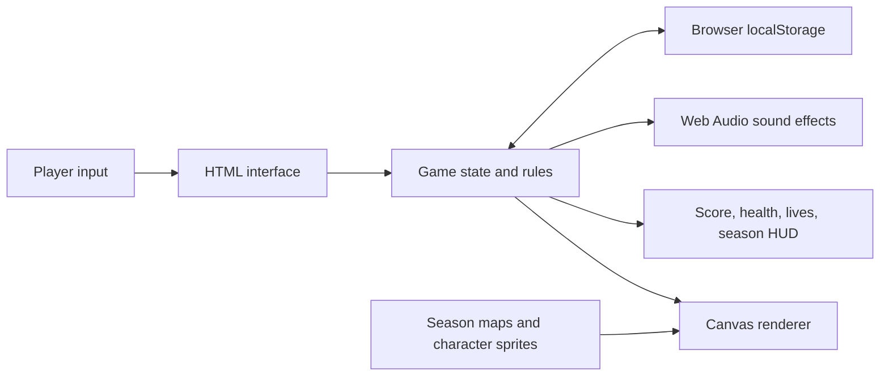

# HarvestBound

HarvestBound is a browser farming game built with HTML, CSS, JavaScript, and the Canvas API. Open `index.html` in a browser to play.

## System architecture

## Gameplay

- Choose a farmkeeper and start a new game from the main menu.
- Plant, water, and harvest crops, sell produce at the market, and rest at the cabin to advance the day.
- The four seasons are four levels. Complete the seasonal goal to earn 100 bonus points and advance safely.
- Harvesting earns 10 points per crop; selling earns another 5 points per crop.
- Missing a seasonal goal costs one life and 34 health. Lose all three lives and the run ends.
- The farm perimeter is lined with spikes. Moving into the fence deals 10 health damage, with a brief cooldown between hits. Losing all health costs a life.
- Resting restores 5 health; completing a level restores 10 health, up to 100.
- Complete every seasonal goal to reach the victory screen. Missing a goal or losing all lives leads to game over.

## Controls and features

| Action | Control |
|---|---|
| Move | WASD or arrow keys |
| Use tool / interact | Space or E |
| Choose tool | 1–4 |
| Pause or resume | Esc or the Pause button |
| Toggle sound | Sound button |

Use **Save game** in the pause menu to save manually. Progress is also autosaved in the current browser. Choose **Load saved game** from the main menu or pause menu to resume. Saves are stored locally in the browser and are not shared across browsers or devices.

Sound effects are generated with the Web Audio API. The game preloads its map and character artwork, caches field coordinates, and limits DOM updates to the HUD and soil grid.
